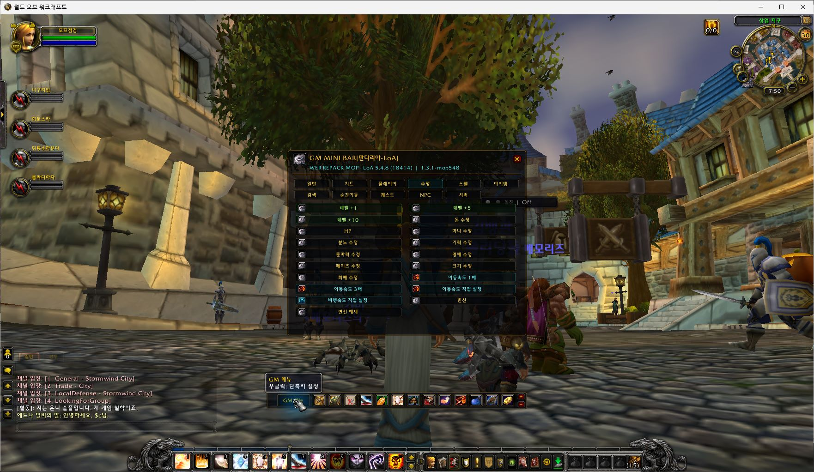

# GM MINI BAR — 판다리아 · LoA

**[English](README.md) | [한국어](README.ko.md)**

**와우5.4.8(18414) / Interface 50400 / Lua 5.1 / Legends of Azeroth Pandaria + 네이티브 Playerbots**용 GM 도구입니다. 제작:**취미연구가(Hobbyist)**.

**v1.0.0 — LoA 최초 공개 배포** · [설치 ZIP 다운로드](https://github.com/hilch1981-prog/loa-gm-addon/releases/download/v1.0.0/GMminibar_LoA_MoP_5.4.8_v1.0.0.zip) · [릴리즈](https://github.com/hilch1981-prog/loa-gm-addon/releases/tag/v1.0.0)

*2026-10-30 원본 한글5.4.8 클라이언트의 실제 화면입니다. 화면의 개발 버전은1.3.1-mop548이며 공개1.0.0은 해당 기능 구현을 유지하고 버전/문서를 정리했습니다. 메뉴 표시 확인과 모든 명령 성공은 구분합니다. [화면 출처](docs/SCREENSHOTS.md).*

# # 클라이언트·코어별 저장소

| 클라이언트 | 코어 | 저장소 | 배포 |
|---|---|---|---|
|3.3.5a |AzerothCore |[아제로스코어](https://github.com/hilch1981-prog/azerothcore-gm-addon) |[릴리즈](https://github.com/hilch1981-prog/azerothcore-gm-addon/releases) |
|5.4.8 |SkyFire 계열 |[기존 MoP](https://github.com/hilch1981-prog/mop-gm-addon) |[릴리즈](https://github.com/hilch1981-prog/mop-gm-addon/releases) |
|**5.4.8** |**LoA Pandaria** |**현재 LoA 저장소** |**[v1.0.0](https://github.com/hilch1981-prog/loa-gm-addon/releases/tag/v1.0.0)** |
|Turtle1.18.1 |Tortoise |[터틀](https://github.com/hilch1981-prog/turtle-gm-addon) |[릴리즈](https://github.com/hilch1981-prog/turtle-gm-addon/releases) |
|7.3.5 |SPP Praevius |[군단](https://github.com/hilch1981-prog/legion-gm-addon) |[릴리즈](https://github.com/hilch1981-prog/legion-gm-addon/releases) |

기존 SkyFire판과 이 LoA판은 클라이언트 버전이 같아도 명령·데이터가 다릅니다. 클라이언트 배포명에 Emucoach가 있어도 서버 코어를 뜻하지 않습니다. 공통 `/gmbar` 별칭 충돌을 피하려면 해당 코어용 애드온 하나만 활성화하세요.

# # 설치와 사용

1. 위 설치 ZIP을 받고 게임을 완전히 종료합니다. 기존 `GMminibar-LoA` 폴더는 먼저 백업합니다.
2. ZIP 안의 **`GMminibar-LoA` 폴더 하나**를 클라이언트 `Interface/AddOns`에 넣습니다.
3. 최종 경로가 `Interface/AddOns/GMminibar-LoA/GMminibar-LoA.toc`인지 확인합니다.
4. 캐릭터 선택의 애드온 목록에서 **GM MINI BAR[판다리아-LoA]**를 켭니다.
5. 서버에서 GM 권한이 있는 캐릭터로 접속해 **GM 메뉴** 또는 `/gmbar`를 사용합니다.

GitHub의 자동 Source code ZIP은 개발용입니다. 사용자는 이름이 지정된 설치 ZIP 하나만 받으면 됩니다. 위치·단축키·즐겨찾기를 보존하려면 `WTF`를 유지하세요. 폴더 접미사LoA는 의도한 구분이며 `GMminibar`로 임의 변경하지 않습니다. 내부 이름은 `GMMPandaria548`,저장 변수는 `GMMPandariaDB`입니다. 별도 MPQ·DLL·SQL·서버 교체 파일은 없고,설치만으로 GM 권한이 생기지 않습니다.

# # 포함 기능

| 구분 | 기능 |
|---|---|
|미니바 |14슬롯,이동/크기 조절,우클릭 단축키,전투 중 설정 변경 제한 |
|GM 도구 |명령 분류 UI,보안 자기 대상 전환,GM/표시/비행/속도,선택 대상 처치,이름 지정 부활 |
|검색 |아이템·퀘스트·NPC·순간이동 로컬 목록,클라이언트 스펠 검색,온라인 플레이어 목록 |
|퀘스트·전문기술 |판다리아용 도우미와 서버 명령 도구 |
|은행·가방 |은행 기능,은행 Ctrl+클릭으로 클라이언트 가방 열기 |
|설정 |기존 LoA 위치·크기·단축키·즐겨찾기 유지 |

주요 명령은 `/gmbar`, `/gmminibar`, `/gmbar show`, `/gmbar hide`, `/gmbar reset`, `/gmbar scale 1.0`, `/gmmop`, `/gmcmd <명령>`, `/gmmdb`입니다. 기능 바로가기는 `/gmmbank`, `/gmmrevive`, `/gmmquest`, `/gmmitem`, `/gmmprof`입니다.

검색 자료는2026-10-28 추출 기준 아이템**80,064**,퀘스트**18,028**,크리처**57,518**,순간이동**1,602**입니다. 한글 DB 이름과 기본 이름 대체를 사용합니다. 목록에 존재하는 것과 실제 지급·퀘스트 완료·정상 착지는 다릅니다. 스펠 이름은 설치된5.4.8 클라이언트에서 인덱싱하며 애드온이 DB에 직접 접속하지 않습니다.

UI는 한국어 중심입니다. 영어 기본 문자열과 중국어 간체/번체·러시아어 일부 번역이 있지만 LoA 호환 표시 중 일부는 한글 고정입니다. 전체 번역과 각 언어 실제 게임 검증을 완료했다고 표시하지 않습니다.

# # 확인 범위

Lua 5.1 구문**24파일**,5개 로케일 각각**115개 모의 검사**를 실행합니다. 전체 TOC 로드,기존 Trinity 전역/설정 보존,14슬롯,잘못된 명령 차단,자기 대상·부활 전송,단축키·전투 제한,생성 목록 수와 ID 검색을 검사합니다. 모의 검사는 실제 하드웨어 보안 동작이나 전체 번역 검증이 아닙니다.

실제 게임에서는 한글5.4.8 클라이언트의 스톰윈드 접속,미니바 표시,GM 메뉴 열기/닫기,LoA 이름을 확인했습니다. 개발 버전1.3.1-mop548의 화면이며 공개1.0.0은 Core/TOC의 버전 두 곳과 해당 파일 줄바꿈,문서만 정리했습니다. 기능 본문·목록·저장 변수는 유지합니다. [게임 확인 기록](GMminibar-LoA/GAME_TEST.md)과 [원본 대조](docs/development-source.json)를 구분합니다.

모든 명령·보안 가방 동작·전문기술 단계·퀘스트·착지·다른 언어 게임·다른 플레이어 동시 적용은 미검증입니다. 문제 보고에는 버전,코어,관련ID,오류 문구를 포함하고 비밀번호나 전체 WTF를 올리지 마세요.

# # 개발과 출처

Python 3.12+와 Lua 5.1을 준비하고 `python scripts/validate.py`, `python scripts/package.py`를 실행합니다. PATH 밖의 Lua는 `LUA51_BIN`으로 지정합니다. 패키지는 단일 폴더·명시적 파일 해시·ZIP CRC·내용 일치를 검사하며 검증기가 manifest를 자동 수정하지 않습니다.

[데이터·기능 출처](GMminibar-LoA/SOURCES.md) · [검증](docs/VALIDATION.md) · [라이선스](LICENSE) · [외부 자료 고지](THIRD_PARTY_NOTICES.md)

GPL-3.0이며 GM MINI BAR/AzerothAdmin 계보를 유지합니다. 게임 기본 텍스처는 클라이언트 내부 경로로 참조합니다. 게임 실행 파일·원본 클라이언트 자료·전체 SQL 덤프는 배포하지 않습니다.
