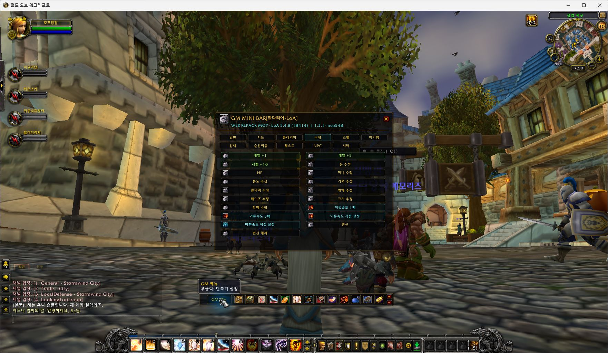

# GM MINI BAR — Pandaria · LoA

**[English](README.md) | [한국어](README.ko.md)**

GM tools for **WoW 5.4.8(18414),Interface 50400,Lua 5.1 / Legends of Azeroth Pandaria + native Playerbots**. Created by **취미연구가(Hobbyist)**. This edition follows the familiar GM MINI BAR layout and keeps the explicit **LoA** identity in its folder and title.

**v1.0.0 — Initial LoA publication** · [Download installation ZIP](https://github.com/hilch1981-prog/loa-gm-addon/releases/download/v1.0.0/GMminibar_LoA_MoP_5.4.8_v1.0.0.zip) · [Release notes](https://github.com/hilch1981-prog/loa-gm-addon/releases/tag/v1.0.0)

[](https://github.com/hilch1981-prog/loa-gm-addon/actions/workflows/validate.yml)



*Actual Korean5.4.8 client capture on2026-10-30,development version1.3.1-mop548. v1.0.0 preserves that implementation and changes version labels/documentation only. This image proves menu rendering and the LoA title,not all commands. [Screenshot provenance](docs/SCREENSHOTS.md).*

# # Choose the matching edition

| Client | Core family | Repository | Downloads |
|---|---|---|---|
| Wrath3.3.5a | AzerothCore | [AzerothCore edition](https://github.com/hilch1981-prog/azerothcore-gm-addon) | [Releases](https://github.com/hilch1981-prog/azerothcore-gm-addon/releases) |
| Pandaria5.4.8 | SkyFire family | [SkyFire edition](https://github.com/hilch1981-prog/mop-gm-addon) | [Releases](https://github.com/hilch1981-prog/mop-gm-addon/releases) |
| **Pandaria5.4.8** | **LoA Pandaria** | **This LoA edition** | **[v1.0.0](https://github.com/hilch1981-prog/loa-gm-addon/releases/tag/v1.0.0)** |
| Turtle1.18.1 | Tortoise | [Turtle edition](https://github.com/hilch1981-prog/turtle-gm-addon) | [Releases](https://github.com/hilch1981-prog/turtle-gm-addon/releases) |
| Legion7.3.5 | SPP Praevius | [Legion edition](https://github.com/hilch1981-prog/legion-gm-addon) | [Releases](https://github.com/hilch1981-prog/legion-gm-addon/releases) |

The SkyFire and LoA editions share a client version but use different command/data contracts. The Emucoach name of a client distribution does not identify the server core. Enable the matching edition only; shared `/gmbar` aliases can conflict when several editions are loaded.

# # Install and open

1. Download the named installation ZIP and close WoW. Back up an existing `GMminibar-LoA` folder.
2. Extract its **single `GMminibar-LoA` folder** into your client's `Interface/AddOns` directory.
3. Confirm `Interface/AddOns/GMminibar-LoA/GMminibar-LoA.toc` exists.
4. Enable **GM MINI BAR[Pandaria-LoA] / GM MINI BAR[판다리아-LoA]** at character selection.
5. Log in with the required server GM permissions; click **GM Menu** or enter `/gmbar`.

Preserve `WTF` to keep settings. Internal namespace:`GMMPandaria548`;SavedVariables:`GMMPandariaDB`. No MPQ,DLL,SQL import or server/client binary is included. GitHub's automatic source archives contain development files; players need only the named installation ZIP. Installing this addon grants no GM access.

# # Features and controls

| Area | Included implementation |
|---|---|
| Minibar |14 slots,movement/scale controls,right-click key binding,combat restrictions |
| GM utilities |Grouped command browser,self-targeted secure GM/visibility/flight/speed controls,selected-target kill,named revival |
| Search |Item,quest,creature and teleport catalogs;runtime client spell browser;online-player browser |
| Quest tools |Quest list/helper and server-command actions;success depends on the target server and current quest |
| Professions |Profession command tools for the documented Pandaria core |
| Bank/bags |Bank routing;Ctrl+click bank opens the client's bag interface |
| Settings |Existing position,scale,bindings and favorites retained in the LoA SavedVariables namespace |

| Slash command | Action |
|---|---|
| `/gmbar` or `/gmminibar` |Open minibar menu |
| `/gmbar show`, `/gmbar hide`, `/gmbar reset` |Visibility and layout |
| `/gmbar scale 1.0` |Minibar scale |
| `/gmmop` |Full UI |
| `/gmcmd <command>` |Send a single GM command |
| `/gmmdb` |Offline database browser |
| `/gmmbank`, `/gmmrevive`, `/gmmquest`, `/gmmitem`, `/gmmprof` |Feature shortcuts |

The snapshot contains **80,064 items,18,028 quests,57,518 creatures and1,602 teleports**,extracted on2026-10-28. Korean DB labels use base-name fallback. Catalog presence does not prove that every item can be granted,every quest completed or every landing reached. The spell browser indexes names through the installed5.4.8 client. No database connection is made by the addon.

The UI is Korean-first. English base strings and partial simplified/traditional Chinese and Russian packs are present;some LoA compatibility labels remain Korean. Full translated UI or actual gameplay in these locales is not claimed. The documentation is bilingual.

# # Validation and limits

Automated validation compiles **24 Lua files in Lua 5.1** and runs **115 mocked checks in each of5 locales**. Checks cover TOC loading,catalog counts/ID search,legacy namespace preservation,14 slots,command input rejection,self-target routing,dead revival transport,bindings and combat layout restrictions. These are mocked API contracts,not real hardware/security acceptance or complete translation tests.

Actual game evidence is narrower: the Korean5.4.8 client entered Stormwind,rendered the minibar and opened/closed the GM menu with the LoA label. The screenshot's development build is1.3.1-mop548. Publication v1.0.0 changes two version literals and normalizes those text files' line endings;function bodies,catalogs and SavedVariables identity remain preserved. See [game tests](GMminibar-LoA/GAME_TEST.md) and [source comparison](docs/development-source.json).

All commands,protected inventory actions,all profession ranks,all quest/teleport destinations,multiplayer behavior and full English/Chinese/Russian gameplay remain unverified. Server-specific patches and GM permissions affect behavior. Record an ID,addon/client/core version and error text when reporting a problem;do not attach credentials or an unfiltered WTF folder.

# # Development and sources

Install Python 3.12+ and Lua 5.1,then run:

```sh
python scripts/validate.py
python scripts/package.py
```

Set `LUA51_BIN` when Lua 5.1 is outside PATH. Packaging is deterministic and checks every byte against the explicit `addon-manifest.json`;validation never silently repairs it. `release.json` records the exact asset hash. See [data sources](GMminibar-LoA/SOURCES.md),[validation](docs/VALIDATION.md) and [third-party notices](THIRD_PARTY_NOTICES.md).

GPL-3.0,with GM MINI BAR/AzerothAdmin lineage retained. See [LICENSE](LICENSE). This is a community tool,not an official Blizzard product. Client textures are referenced by their internal paths;no client archives are redistributed.
